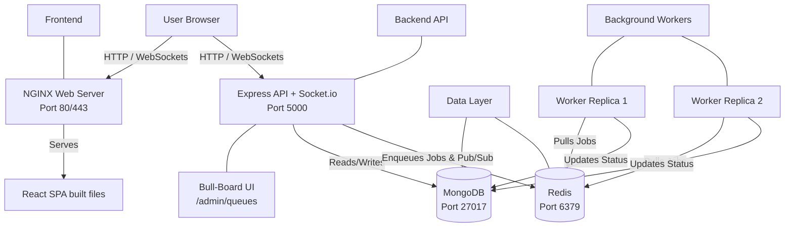

# TaskFlow Production Deployment Guide

This document outlines the final production architecture and provides step-by-step instructions for deploying TaskFlow to a cloud provider like AWS EC2 or a DigitalOcean Droplet.

## 1. System Architecture



## 2. Server Requirements
- **OS:** Ubuntu 22.04 LTS (or newer)
- **RAM:** Minimum 2GB (4GB recommended for multiple worker replicas and MongoDB)
- **Software:** Docker and Docker Compose installed

## 3. Deployment Steps

### Step 1: Clone the Repository
SSH into your production server and clone the code:
```bash
git clone https://github.com/yourusername/taskflow.git
cd taskflow
```

### Step 2: Configure Environment Variables
Copy the `.env.example` templates to real `.env` files and populate them with production secrets.

```bash
cp backend/.env.example backend/.env
cp frontend/.env.example frontend/.env
```

**CRITICAL PRODUCTION VARIABLES:**
- `JWT_SECRET`: Must be a long, randomly generated string.
- `FRONTEND_URL`: Must be exactly the domain name where the frontend is hosted (e.g., `https://taskflow.yourdomain.com`).
- `VITE_API_BASE_URL`: Must be the domain where the API is hosted (e.g., `https://api.yourdomain.com/api`).

### Step 3: Start the Production Stack
Run Docker Compose in detached mode. This will automatically pull the necessary databases, build your Node/React images, and start the system.

```bash
# Build and start all containers
docker compose up -d --build

# Scale workers if you expect high traffic
docker compose up -d --scale worker=3
```

## 4. Production Best Practices & Next Steps

1. **Reverse Proxy & SSL:** You should place a reverse proxy (like Nginx Proxy Manager, Caddy, or AWS ALB) in front of the Docker containers to handle SSL/HTTPS certificates via Let's Encrypt.
2. **Managed Databases:** For a true enterprise deployment, do not run MongoDB and Redis inside Docker. Instead, use managed services like **MongoDB Atlas** and **AWS ElastiCache (Redis)**. Update the `MONGODB_URI` and `REDIS_URI` in your `.env` file to point to these managed cloud instances.
3. **Log Rotation:** Docker logs can consume massive amounts of disk space over time. Configure `max-size` and `max-file` logging limits in your `docker-compose.yml` or Docker daemon configuration.
