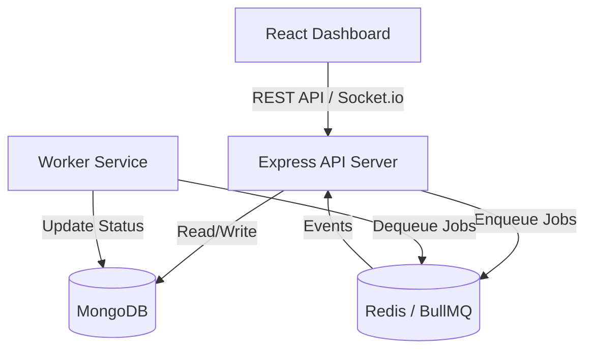
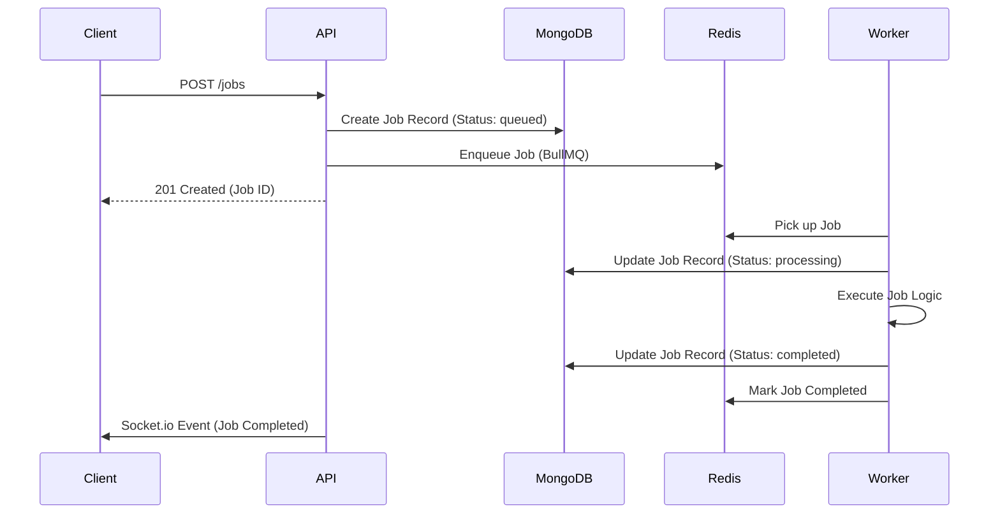
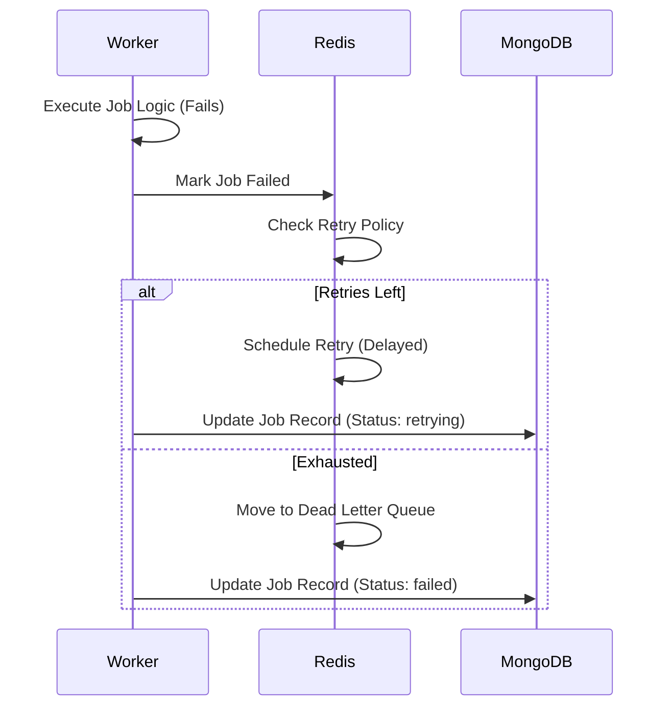

# Architecture

## Components

### React Dashboard
A Single Page Application built with React and Vite. It provides a UI to submit jobs, monitor their status, view metrics, and manage workers.

### Express API Server
A Node.js/Express REST API that acts as the entry point for the frontend. It handles authentication, validates requests, persists job metadata to MongoDB, and pushes jobs to the Redis queue.

### Authentication
JWT-based authentication protecting the API and WebSocket connections.

### MongoDB and Mongoose
The primary database for persisting users, job metadata, and worker status. It serves as the source of truth for historical job data.

### Redis and BullMQ
Redis acts as the in-memory message broker. BullMQ manages the queues, job scheduling, retries, and rate limiting.

### Independent Worker Service
A separate Node.js process dedicated to consuming jobs from BullMQ. It executes the actual job logic and updates the job status in MongoDB upon completion or failure.

### Socket.io
Provides real-time, bi-directional communication between the API server and the React dashboard to stream job status updates.

### Docker Compose
Orchestrates the entire stack for local development, managing the API, Worker, MongoDB, and Redis containers.

## High-Level System Architecture

## Job Submission and Processing Flow

## Job Failure and Retry Flow

